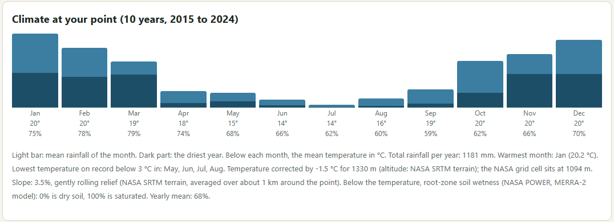
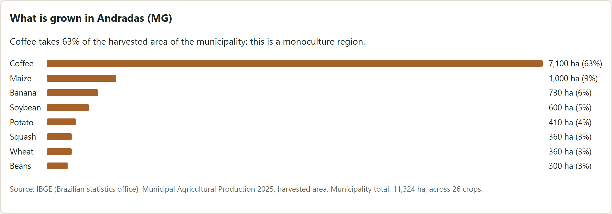

# Field Shift

Decision support for crop rotation, built for the NASA Space Apps Challenge 2026, challenge **"Field Shift: Adapting Farms with NASA Data"**.

## ▶ [Click here to use Field Shift online](https://lucasbnas435.github.io/nasa-space-apps-2026/)

Runs in the browser, on a computer or a phone. No login, no install, no API key. Press **Compare** with the default values to see a real farm in Andradas, Brazil, or enter your own coordinate. English by default, with Brazilian Portuguese selectable at the top of the page.


**Team Green Window:** José Luiz Kemp Filho and Lucas Nascimento.

**Presentation:** [7 slides (PDF)](presentation/Field-Shift-demo.pdf) · [PowerPoint](presentation/Field-Shift-demo.pptx)

A grower chooses a production profile (vegetables, annual crops, or perennials such as coffee and banana), enters a location, what one bed or field receives over two years and what matters most to them. The tool fetches ten years of NASA climate data for that point and returns:

1. **A product-by-month calendar**: in which months each crop fits the local temperature, where it sits at the limit and where it falls outside (or faces frost), with the reason for every cell.
2. **Three rotation strategies compared**, always including the current one:
   - the current rotation;
   - the same crops, with green manure in the idle windows;
   - alternating plant families and fitting crops to the climate.
3. For each strategy: why it is suggested, the evidence behind it, benefits over the current rotation, and risks that need local review.
4. **Municipal context**: what is grown in the grower's municipality, by harvested area, from the Brazilian statistics office (IBGE). It shows at a glance whether the region is a monoculture.
5. A closing box, **"Limits of this tool"**, listing on screen what the tool does not model.

The tool supports the grower's and the agronomist's judgment. It does not replace it.

The interface is in English by default, with Brazilian Portuguese selectable at the top of the page (or with `?lang=pt` in the address). It is written for growers with little technical background.

## How it answers the challenge

| The challenge asks for | Where Field Shift does it |
|---|---|
| NASA Earth observations | NASA POWER (10 years of monthly rainfall, temperature and root-zone soil wetness for the point) and NASA SRTM (altitude and slope of the field). Every score and every colored square is computed from them. |
| Crop characteristics | Crop table with plant family, cycle length, temperature range, frost and heavy-rain sensitivity, protected cultivation. |
| Farmer priorities | Four sliders: climate fit, pest and disease cycles, soil protection, irrigation. They weight the final score, so two growers on the same land can get different answers. |
| Seasons when crops are vulnerable | Product-by-month calendar: frost, heat and cold outside the crop's range, heavy rain on open-field leaf crops, each with its reason. |
| Times when fields are bare | Months with an empty bed and the rainfall that falls on bare soil, per strategy. |
| At least three strategies, including the existing one | Current rotation, current rotation plus green manure, and alternating plant families fitted to the climate. Perennials: three inter-row options. |
| Why, evidence, benefits, gaps and risks per strategy | Each card states why it is suggested, the evidence from NASA data, the benefits over the current rotation, and the risks that need local review. Information gaps are listed on screen in "Limits of this tool". |
| Pest-cycle disruption, water demand, erosion | Plant-family repetition, irrigation estimate, and erosion risk from rainfall on bare soil combined with the slope read from SRTM. |
| Market suitability | Municipal context from IBGE: what the region already grows and whether it is a monoculture. Prices are not modeled. |
| Support, not replace, local expertise | Stated in the header, on every card and in the closing box. |

## What it looks like

Ten years of NASA POWER climate for the point, corrected to the real altitude read from NASA SRTM:



The best-scoring rotation for the grower's priorities, with reasons, evidence, benefits and risks:


What is grown in the municipality, from the Brazilian statistics office:



## How to run

**Online:** open https://lucasbnas435.github.io/nasa-space-apps-2026/. The site is published with GitHub Pages straight from the `main` branch, so it always runs the latest code.

**Locally:** no build, no backend, no API key.

```bash
python -m http.server 5188
```

Then open `http://localhost:5188`. Either way, the page calls NASA POWER, Open-Elevation, IBGE and Nominatim directly from the browser.

Model self-check against live NASA data (Node 18+):

```bash
node teste.js
```

## NASA data used

**NASA POWER** (Prediction Of Worldwide Energy Resources), monthly point API, agroclimatology community, 2015 to 2024:

| Parameter | Use |
|---|---|
| `PRECTOTCORR` | monthly rainfall: the mean, and the lowest of the ten years for each month |
| `T2M` | monthly mean temperature, matched against each crop's range |
| `T2M_MIN` | lowest temperature recorded per month, frost risk |
| `T2M_MAX` | highest temperature recorded per month |
| `GWETROOT` | root-zone soil wetness (0 = dry, 1 = saturated), mean and lowest of the ten years per month; flags crop-months with dry soil |

**NASA SRTM** (Shuttle Radar Topography Mission) elevation, served by the Open-Elevation API: altitude and slope of the grower's point. One request per run reads the point and four neighbors about 330 m to the north, south, east and west; the slope comes from their differences.

The two datasets work together. The POWER grid cell is about 50 km wide and reports its own mean altitude. On every run, the tool reads the real altitude of the point from SRTM (a value typed by the grower overrides it until the coordinate changes) and corrects temperature by the standard lapse rate (0.65 °C per 100 m). In mountain areas this changes the answer: at the default point the cell sits at 1,094 m and the field at about 1,330 m, a 1.5 °C difference. Rainfall is not corrected.

### Satellite, model and ground data

POWER does not come from a weather station on the farm. Its temperature and rainfall come from NASA's MERRA-2 reanalysis, a model that combines satellite and ground observations into a continuous global grid. That is what makes it available for any point on Earth, with ten years of history and no gaps, including farms with no station nearby. The trade-off is resolution: one value for a cell about 50 km wide. A station on the farm measures the exact place but only from the day it was installed, and often with gaps. The two complement each other: a grower with a rain gauge or a thermometer can check the tool's numbers against their own, and where they disagree, the local measurement wins.

## Other data sources

| Source | Use |
|---|---|
| IBGE, Produção Agrícola Municipal (SIDRA table 5457) | harvested area per crop in the municipality, latest year |
| IBGE localities API | municipality code |
| OpenStreetMap Nominatim | municipality name from the coordinate, sent rounded to two decimals (about 1 km) |

All three are called from the browser. If they fail, the climate analysis still runs.

## Perennial crops

Coffee and banana do not rotate: they stay in place for years. For this profile the tool compares what happens **between the rows**: bare soil, green manure, or an annual crop (beans) intercropped in the wettest window that fits the climate, with green manure the rest of the time. The diversity score measures how many plant families share the area, so a pure monoculture scores zero.

## How the model works

Everything is in `modelo.js`, as pure functions that run in the browser and in Node.

- **Timeline:** 24 months, starting in July.
- **Crop table (`CULTURAS`):** 24 vegetables, 6 annual crops, 2 perennials and 3 cover crops, each with plant family, cycle length, temperature range, frost sensitivity, sensitivity to heavy rain in open field and whether it is grown under cover.
- **Monthly status (`statusMes`):** good, attention or risk, always with the reason in plain language.
- **Evaluation (`avaliar`):** four scores from 0 to 1:
  - climate fit (share of crop-months inside the temperature range);
  - pest cycle break (same plant family in sequence);
  - soil protection (share of rainfall that falls on an empty bed);
  - irrigation (reference demand minus mean rainfall).
- **Final score (`pontuar`):** weighted by the grower's four priority sliders.
- **Erosion risk (`riscoErosao`):** rain on bare soil combined with the slope class of the Embrapa relief classification (flat below 3%, gently rolling 3 to 8%, rolling 8 to 20%, hilly or steeper above 20%). Below 100 mm of rain on bare soil in two years the risk is low on any slope; above it, the risk follows the slope: low, moderate, high, very high. It appears as evidence, risk and benefit on each card but **does not change the score**, so the ranking of strategies never depends on whether the elevation service answered. When the slope is unknown, the card says erosion was not assessed instead of guessing.
- **Alternatives:** `cobrirSolo` fills idle windows of two months or more with green manure (sunn hemp when warm, black oat when cold). `alternar` replaces a crop that repeats the previous family, or that falls outside its climate window, with the best-fitting crop from the table; when nothing fits, the bed rests under green manure.

### Why rules and not a trained model

The strategies are generated by short, readable rules instead of a trained machine-learning model. A grower or agronomist can check every step: which month failed, by how many degrees, and which crop replaced which. There is also no labeled data of rotation outcomes for small farms in this region to train on. When the crop table is reviewed by an agronomist, the rules improve immediately, with no retraining.

### How uncertainty is shown

- The climate chart shows the mean rainfall and the lowest of the ten years for each month, so the grower sees the bad case, not only the average.
- Frost risk uses the lowest temperature on record in each month, not the mean.
- Each month is good, attention or risk, never a single yes or no. "Attention" means the crop is at the edge of its range and the decision depends on local knowledge (cultivar, microclimate, protection).
- The final score is a comparison between strategies on the same land, not a yield forecast.

## Why these practices help the soil

- **Green manure (cover crops):** a crop grown to protect and feed the soil, not to be sold. It keeps roots and leaves over the ground when it would otherwise be bare, so heavy rain hits plants instead of soil, which reduces erosion and helps water soak in. When cut, it returns organic matter.
- **Nitrogen-fixing crops (legumes):** beans, green beans, soybean and sunn hemp host bacteria in their roots that take nitrogen from the air. Part of it stays for the next crop, which can reduce fertilizer.
- **Deep-rooting grasses:** black oat, sorghum and brachiaria grass have dense roots that open channels in compacted soil and add organic matter at depth.
- **Drought-tolerant crops:** sorghum needs less water than maize and fits drier windows.
- **Alternating plant families:** many pests and diseases attack one family (for example, clubroot in brassicas). Planting another family next starves them of their host and breaks the cycle.

## Key terms

| Term | Meaning in this tool |
|---|---|
| Frost risk | the lowest temperature recorded in that month, over ten years, was below 3 °C at 2 m height. Frost on the ground can happen with the air a few degrees above zero. |
| Lapse rate | air gets colder with altitude, about 0.65 °C for every 100 m. Used to move the NASA grid temperature to the altitude of the field. |
| Slope | rise of the land over distance, in %. A 10% slope rises 10 m every 100 m. The steeper the land, the faster rain runs off and carries soil. |
| Bare soil | months with nothing planted in the bed, field or inter-row. Rain that falls then is the main driver of erosion. |
| Irrigation estimate | a simple water balance: a reference crop water use of 120 mm per month (4 mm per day) minus the mean rainfall of that month. It is not crop evapotranspiration; it is a common yardstick to compare strategies. |
| Root-zone soil wetness | how much water the soil holds where roots grow, from 0% (dry) to 100% (saturated), estimated by NASA's MERRA-2 model for the grid cell. Below 50%, a crop in open field tends to need irrigation. |
| Plant family | botanical family (brassicas, nightshades, legumes, grasses...). Crops of the same family share many pests and diseases. |

## Limits

These are also shown on screen.

- The crop table (temperature ranges, cycle lengths) was written from general reference knowledge and **has not been reviewed by a local agronomist yet**. Summer and winter cultivars shift these ranges.
- Water demand uses a single reference of 4 mm per day for every crop.
- Soil wetness is a model estimate for the 50 km grid cell, not a measurement of the field's soil. The 50% threshold for dry soil has not been reviewed by an agronomist yet.
- For greenhouse crops the tool uses outside air temperature, which is lower than inside the structure.
- No soil analysis or pest history of the area.
- The SRTM slope is read on a grid of about 250 m and averages about 1 km around the point, so it smooths out steep fields (at the default point it reads about 3.5%, while 30 m SRTM gives about 14%). The grower can type the real slope. If the elevation service is down, altitude and slope stay blank and the tool says so.
- No prices, costs or market demand.
- For coffee and banana the tool looks only at the inter-row. Spacing, age of the plantation, canopy shade and mechanization decide whether anything can be planted there, and none of that is modeled.
- One bed at a time. Planning supply of every product across many beds is out of scope.
- Ten years of past climate do not guarantee the next one.

## What comes next

- Review of the crop table by local agronomists, cross-checked against FAO ECOCROP and Embrapa planting calendars.
- Soil moisture from SMAP (finer than the MERRA-2 estimate used today) and rainfall from GPM IMERG; field-scale slope from 30 m SRTM.
- Soil information for the point (texture and organic matter), from the grower or from global soil maps.
- An interactive map to pick the field instead of typing a coordinate.
- Planning many beds at once, to keep supply of every product through the year.
- Other official Brazilian sources: CONAB (crop forecasts) and MapBiomas (land use maps).

## Use of AI (SI)

The code, the crop reference table, the presentation and this document were written with Claude Code (Anthropic) under the direction of the team, who defined the problem, the target grower and the scope, and reviewed the results. The running application does not call any AI model: every number on screen comes from NASA POWER and SRTM data, IBGE statistics and the rules in `modelo.js`. The images in the presentation and in this document are screenshots of the working tool, not AI-generated images.

## License and third-party data

Original code and content in this repository are licensed under the **Apache License 2.0** (see `LICENSE`).

| Source | Terms |
|---|---|
| NASA POWER | NASA open data, free and open |
| NASA SRTM, via Open-Elevation | SRTM is public domain; the Open-Elevation service is free and open source |
| IBGE (SIDRA and localities APIs) | Brazilian official open data, free to use with attribution |
| OpenStreetMap Nominatim | data © OpenStreetMap contributors, ODbL 1.0 |

No third-party code libraries are used: the page is plain HTML, CSS and JavaScript.

## Files

| File | Content |
|---|---|
| `index.html` | the page: form, climate chart, calendar, strategy cards |
| `modelo.js` | crop table and rotation model |
| `teste.js` | self-check of the model against live NASA POWER and IBGE data |
| `LICENSE` | Apache License 2.0 |
| `presentation/` | presentation (7 slides, PDF and PowerPoint) and screenshots of the working tool |
| `.nojekyll` | tells GitHub Pages to publish the files as they are, without the Jekyll build |
