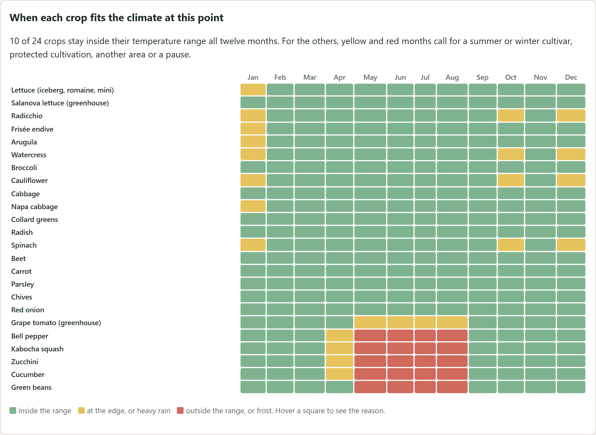
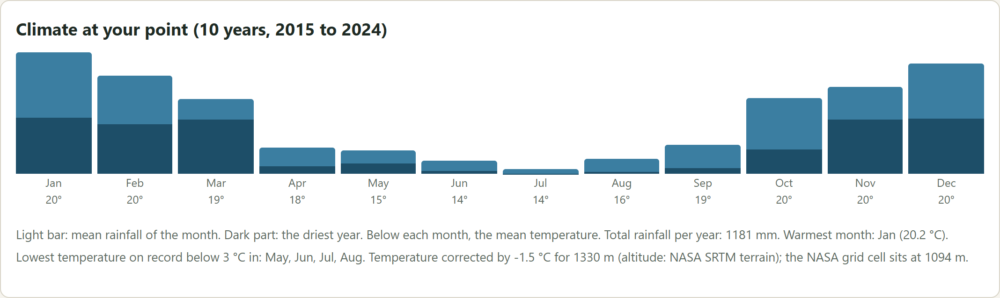
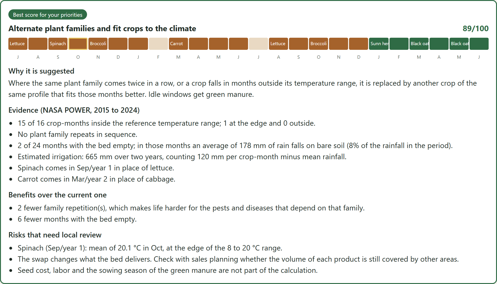

# Field Shift

Decision support for crop rotation, built for the NASA Space Apps Challenge 2026, challenge **"Field Shift: Adapting Farms with NASA Data"**.

**Team Janela Verde:** José Luiz Kemp Filho and Lucas Nascimento.

**Demo:** [7-slide deck (PDF)](demo/Field-Shift-demo.pdf) · [PowerPoint](demo/Field-Shift-demo.pptx)



A grower chooses a production profile (vegetables, annual crops, or perennials such as coffee and banana), enters a location, what one bed or field receives over two years and what matters most to them. The tool fetches ten years of NASA climate data for that point and returns:

1. **A product-by-month calendar**: in which months each crop fits the local temperature, where it sits at the limit and where it falls outside (or faces frost), with the reason for every cell.
2. **Three rotation strategies compared**, always including the current one:
   - the current rotation;
   - the same crops, with green manure in the idle windows;
   - alternating plant families and fitting crops to the climate.
3. For each strategy: why it is suggested, the evidence behind it, benefits over the current rotation, and risks that need local review.
4. **Municipal context**: what is grown in the grower's municipality, by harvested area, from the Brazilian statistics office (IBGE). It shows at a glance whether the region is a monoculture.
5. A closing box, **"what this tool does not know"**, stating its limits on screen.

The tool supports the grower's and the agronomist's judgment. It does not replace it.

The interface is in English by default, with Brazilian Portuguese selectable at the top of the page (or with `?lang=pt` in the address). It is written for growers with little technical background.

## What it looks like

Ten years of NASA POWER climate for the point, corrected to the real altitude read from NASA SRTM:



The best-scoring rotation for the grower's priorities, with reasons, evidence, benefits and risks:



What is grown in the municipality, from the Brazilian statistics office:


## How to run

No build, no backend, no API key.

```bash
python -m http.server 5188
```

Then open `http://localhost:5188`. The page calls the NASA POWER API directly from the browser.

Model self-check against live NASA data (Node 18+):

```bash
node teste.js
```

## NASA data used

**NASA POWER** (Prediction Of Worldwide Energy Resources), monthly point API, agroclimatology community, 2015 to 2024:

| Parameter | Use |
|---|---|
| `PRECTOTCORR` | monthly rainfall, mean and driest year per month |
| `T2M` | monthly mean temperature, matched against each crop's range |
| `T2M_MIN` | lowest temperature recorded per month, frost risk |
| `T2M_MAX` | highest temperature recorded per month |

**NASA SRTM** (Shuttle Radar Topography Mission) elevation, served by the Open-Elevation API: altitude of the grower's point.

The two datasets work together. The POWER grid cell is about 50 km wide and reports its own mean altitude. The tool reads the real altitude of the point from SRTM (or from the grower) and corrects temperature by the standard lapse rate (0.65 °C per 100 m). In mountain areas this changes the answer: at the default point the cell sits at 1,094 m and the field at about 1,330 m, a 1.5 °C difference. Rainfall is not corrected.

## Other data sources

| Source | Use |
|---|---|
| IBGE, Produção Agrícola Municipal (SIDRA table 5457) | harvested area per crop in the municipality, latest year |
| IBGE localities API | municipality code |
| OpenStreetMap Nominatim | municipality name from the coordinate, sent rounded to two decimals (about 1 km) |

All three are called from the browser. If they fail, the climate analysis still runs.

## Perennial crops

Coffee and banana do not rotate: they stay in place for years. For this profile the tool compares what happens **between the rows**: bare soil, green manure, or an annual crop (beans) intercropped in the wettest window that fits the climate, with green manure the rest of the time. The diversity score measures how many plant families share the area, so a pure monoculture scores zero.

## How the model works

Everything is in `modelo.js`, as pure functions that run in the browser and in Node.

- **Timeline:** 24 months, starting in July.
- **Crop table (`CULTURAS`):** 24 vegetables, 6 annual crops, 2 perennials and 3 cover crops, each with plant family, cycle length, temperature range, frost sensitivity, sensitivity to heavy rain in open field and whether it is grown under cover.
- **Monthly status (`statusMes`):** good, attention or risk, always with the reason in plain language.
- **Evaluation (`avaliar`):** four scores from 0 to 1:
  - climate fit (share of crop-months inside the temperature range);
  - pest cycle break (same plant family in sequence);
  - soil protection (share of rainfall that falls on an empty bed);
  - irrigation (reference demand minus mean rainfall).
- **Final score (`pontuar`):** weighted by the grower's four priority sliders.
- **Alternatives:** `cobrirSolo` fills idle windows of two months or more with green manure (sunn hemp when warm, black oat when cold). `alternar` replaces a crop that repeats the previous family, or that falls outside its climate window, with the best-fitting crop from the table; when nothing fits, the bed rests under green manure.

## Limits

These are also shown on screen.

- The crop table (temperature ranges, cycle lengths) was written from general reference knowledge and **has not been reviewed by a local agronomist yet**. Summer and winter cultivars shift these ranges.
- Water demand uses a single reference of 4 mm per day for every crop.
- For greenhouse crops the tool uses outside air temperature, which is lower than inside the structure.
- No soil analysis, slope or pest history of the area.
- No prices, costs or market demand.
- For coffee and banana the tool looks only at the inter-row. Spacing, age of the plantation, canopy shade and mechanization decide whether anything can be planted there, and none of that is modeled.
- One bed at a time. Planning supply of every product across many beds is out of scope.
- Ten years of past climate do not guarantee the next one.

## Not done yet

- Other NASA datasets named in the challenge (SMAP, GPM, ECOSTRESS, Landsat, MODIS, GRACE, GEDI).
- Interactive map.
- Other official Brazilian sources: CONAB (crop forecasts) and MapBiomas (land use maps).

## Use of AI

The code, the crop reference table, the demo deck and this document were written with Claude Code (Anthropic) under the direction of the team, who defined the problem, the target grower and the scope, and reviewed the results. The running application does not call any AI model: every number on screen comes from NASA POWER and SRTM data, IBGE statistics and the rules in `modelo.js`. The images in the deck and in this document are screenshots of the working tool, not AI-generated images.

## License and third-party data

Original code and content in this repository are licensed under the **Apache License 2.0** (see `LICENSE`).

| Source | Terms |
|---|---|
| NASA POWER | NASA open data, free and open |
| NASA SRTM, via Open-Elevation | SRTM is public domain; the Open-Elevation service is free and open source |
| IBGE (SIDRA and localities APIs) | Brazilian official open data, free to use with attribution |
| OpenStreetMap Nominatim | data © OpenStreetMap contributors, ODbL 1.0 |

No third-party code libraries are used: the page is plain HTML, CSS and JavaScript.

## Files

| File | Content |
|---|---|
| `index.html` | the page: form, climate chart, calendar, strategy cards |
| `modelo.js` | crop table and rotation model |
| `teste.js` | self-check of the model against live NASA POWER and IBGE data |
| `LICENSE` | Apache License 2.0 |
| `demo/` | demo deck (PDF and PowerPoint) and screenshots of the working tool |
